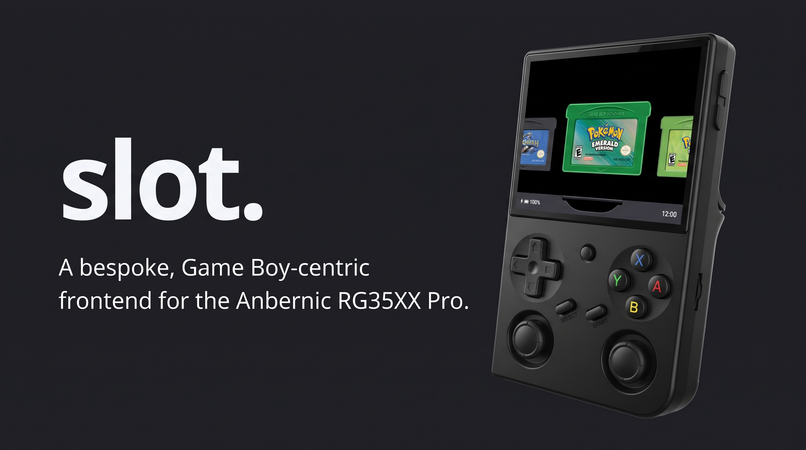

---

# Fragile

A bespoke, skeuomorphic retro gaming frontend for Anbernic handheld consoles (RG35XXSP, RG35XX Pro, RG35XX Plus, RG35XX-H, RG28XX, RG34XX, and other H700-based devices).

Originating from [slot](https://github.com/BrandonKowalski/slot) by Brandon T. Kowalski, **Fragile** expands the experience across multiple generations of retro handheld and home console gaming with modern creature comforts, over-the-air updates, screenshot management, and community enhancements.

---

## Key Features

- **7 Core Systems + PokeDaisy Companion**:
  - **Game Boy Advance** (GBA cartridge with custom plastic colours & PCB view)
  - **Game Boy & Game Boy Color** (Notched & rounded paks, custom palettes & PCB view)
  - **Nintendo Entertainment System** (NES cartridge with ribbed grip, insertion arrow & PCB view)
  - **Super Nintendo** (SNES cartridge with ribbed wings, label well & PCB view)
  - **PlayStation 1** (PS1 CD-ROM with ring art, disc swapping & mirror view)
  - **Nintendo DS** (Sculpted DS Game Card & slot housing, nickname/RTC timezone sync, and Left/Right analog stick stylus control)
  - **PokeDaisy Companion** (`Games/PokeDaisy/` sharing one shelf with bundled GBA/GBC cores, daisymarks & hardware save folders)
- **Shelf Life, Cart Interiors & Game Boy Printer**:
  - **Shelf Life**: Shrink wrap & localized price tags (`$` / `¥` / `€`) on unplayed carts that tear open on insert, time-based dust & play-hour edge wear, Hold `B` wipe-and-shine, and `Clean All Carts`.
  - **Inside PCBs & Stickers**: Press `START` on any system (including single-core shelves) to view its interior board or disc mirror with handwritten stopwatch play-time and gold RetroAchievements stickers.
  - **Game Boy Printer**: Press `SELECT` on an opened cart with cached RetroAchievements to print achievement cards to `Screenshots/<system>/<game>/`.
- **Handwritten Labels, Display & Shaders**:
  - RetroArch GLSL shaders, adaptive LCD Grid (`LcdGrid` / `Lcd3x`), `Shimmerless Grid` for GB/GBC, GPU ping-pong Frame Blending, Night Dim, per-channel Display Calibration (`Warmth`, `Tint`, `Gamma Curve`), bezels, and dynamic wallpaper-aware shelf ink.
  - Stroke-based handwritten labels (`NoSmear.ttf`) directly on bare cartridges for unlabelled ROMs.
- **Over-The-Air (OTA) Updates**:
  - Wi-Fi update detection, background chunked streaming downloads, cryptographic SHA-256 validation, and fail-safe atomic swap with 3-crash rollback safeguards.
- **ROM Soft-Patching, Save Safety & Kid Mode**:
  - Automatic in-memory `.ips`, `.bps`, and `.ups` ROM soft-patching alongside loaded ROMs.
  - Rolling `.sav` backups (3 kept per game, at most hourly), stale auto-resume retirement when newer `.sav` files exist on SD, `syncfs` flushing, atomic staging, and decoupled autosaves.
  - Play-time tracking (`Saves/play_log.txt`), `Kid Mode` menu locking, and daily `Kid Play Time` allowances with a 5-minute warning and auto-save/eject.
- **In-Game Screenshot & Gallery**:
  - Hotkey screenshot capture and Polaroid-style carousel photo viewer with in-game deletion prompts.
- **Power, Audio & Screensavers**:
  - Idle screensaver styles (Fade, Retro Logo, Blackout), sleep (`Doze`) GPU loop pause, auto-sleep timers, hot-plug USB DAC audio routing, and ALSA write pacing.
- **Connectivity & Networking**:
  - Softcore RetroAchievements over Wi-Fi (with offline patch caching & unlock queue sync)
  - Two-device wireless link cable multiplayer
  - Bluetooth audio and controller pairing, 51-city DST-aware Timezone & RTC drift learning, Web Dashboard, optional RomM server browsing, and SSH configuration

---

## Supported Devices

| Device | Supported | Notes |
| :--- | :--- | :--- |
| **Anbernic RG35XXSP** | Yes | Full lid sleep, LED, and clamshell integration |
| **Anbernic RG35XX Pro** | Yes | Left Stick as D-Pad, dual analog stick mapping |
| **Anbernic RG35XX Plus** | Yes | Full support |
| **Anbernic RG35XX-H** | Yes | Dual analog sticks, horizontal layout |
| **Anbernic RG28XX** | Yes | Compact layout |
| **Anbernic RG34XX** | Yes | Full support |
| **Anbernic RG34XXSP** | Yes | Full support |

---

## Installation & Updates

1. **First-Time Install**:
   - Download the latest `slot-vX.Y.Z-h700.zip` from [Releases](https://github.com/fragilesilver/slot-fragile/releases).
   - Unzip and copy the contents onto the root of SD2.
2. **Over-The-Air (OTA) Updates**:
   - Once connected to Wi-Fi, navigate to **Settings > System > Software Update**.
   - Fragile will check for updates, download the binary in the background, and prompt to restart to apply!

---

## Credits & Acknowledgements

Fragile is built upon the incredible work of creators across the retro handheld community:

- **[Brandon T. Kowalski](https://github.com/BrandonKowalski)**: Original author and designer of [slot](https://github.com/BrandonKowalski/slot).
- **[Markus Maribu](https://github.com/MarkusMaribu)**: The exquisite skeuomorphic cartridge, pak, and console artwork and bezels.
- **Community Fork Authors**:
  - [nickclyde/slot-plus](https://github.com/nickclyde/slot-plus): On-screen keyboard, RetroAchievements, and list shelves.
  - [roygravy/slot](https://github.com/roygravy/slot): Gambatte integration, Linux EGL surface, dynamic shelf ink, and RetroArch `.cht` cheat engine.
  - [cloudwithax/unslot](https://github.com/cloudwithax/unslot): Multi-system architecture, Wi-Fi supplicant, and Bluetooth management.
  - [pvaibhav/slot](https://github.com/pvaibhav/slot): LaunchBox cart indexing, sticker crop algorithms, stale-resume safety, and BaseOS.
  - [nelynes/slotPlus](https://github.com/nelynes/slotPlus): ROM soft-patching, rolling save backups, play log & Kid Play Time, Shelf Life, cart interior stickers, Game Boy Printer achievement printouts, 1-line menu help, What's New dot, DS card look & nickname/RTC options, and PokeDaisy support.
  - [marghost/slot_modded](https://github.com/marghost/slot_modded): Shelf position memory, battery indicators, and Integer Scale.
  - [markbruno/slot-plus](https://github.com/markbruno/slot-plus): 12-hour clock and GLSL shaders.
  - [Baggio94/slot-konkr](https://github.com/Baggio94/slot-konkr): GBA Color and LCD Grid V2 shader ports.
  - [suprsomething/slot.advance](https://github.com/suprsomething/slot.advance): Card space monitoring and per-game settings.
- **Core Emulators**:
  - [mGBA](https://github.com/libretro/mgba) by Jeffrey Pfau and contributors (MPL-2.0)
  - [gpSP](https://github.com/libretro/gpsp) by Exophase, notaz and libretro (GPL-2.0)
  - [Gambatte](https://github.com/libretro/gambatte-libretro) by sinamas and libretro (GPL-2.0)
  - [FCEUmm](https://github.com/libretro/libretro-fceumm) by FCE Ultra and libretro (GPL-2.0)
  - [Snes9x](https://github.com/libretro/snes9x) by the Snes9x team and libretro (Snes9x License)
  - [Supafaust](https://github.com/libretro/supafaust) by Mednafen and libretro (GPL-2.0)
  - [PCSX ReARMed](https://github.com/libretro/pcsx_rearmed) by notaz, PCSX and libretro (GPL-2.0)
  - [DSperate](https://github.com/beebono/DSperate) by beebono and DSperate contributors (GPL-3.0)
  - [PokeDaisy](https://github.com/lidor30/pokedaisy) by lidor30, armGBA & mGBA contributors (GPL-3.0)

See [CREDITS.md](CREDITS.md) for full licensing information and component attribution.
